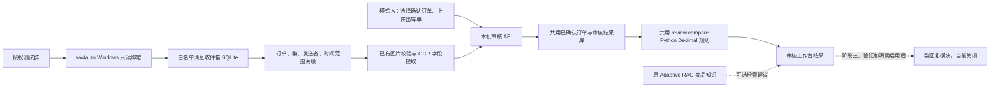

# 嘉惠审核系统：双入口架构与开发计划

补充候选：已核对用户提供的 `FreeWisdom/wxauto-4.0` 固定提交，见 [wxauto4 接入评估](WXAUTO4-EVALUATION.md)。其 UIAutomation、最小化限制、初始化删除更新文件和授权不明等问题尚不满足正式只读入口要求，未启用实时接入；已提供 [wxauto4 Windows 被动诊断入口](WXAUTO4-TRIAL.md)，先用固定提交隔离副本做实机对照，不将 wxauto4 与 wx4auto 混称。

本文件将 wx4auto 列为正式的 Windows 消息入口。保留原 Adaptive RAG、现有私聊、群审单和桌面工作流代码；核心审核不依赖微信或 RAG。当前可确认的功能基线是本仓库，未取得其他“上一份系统”设计稿，不能据此声称已覆盖未提供的功能。



## 当前实现边界

| 模块 | 实现与限制 |
| --- | --- |
| 独立审核引擎 | `shipment_bot/workbench.py`：两入口共用 `AuditService`；继续使用 `review.compare` 的商品/规格标准化、单位、Decimal 数量/成交价/金额/客户核对；没有第二套判断逻辑 |
| 确认订单库 | 与消息、任务共用一个 SQLite 文件；确认订单号不可覆盖，修改订单需新版本 ID；目前确认表示可信本机操作者提交，不代表已实现员工角色权限 |
| 工作台接口 | `workbench_api.py`：确认/列出订单、结构化出库单审核、本地图片提取审核、查询结果；Bearer 鉴权，CLI 只绑定回环；这是 API 基础，不是已完成的新工作台页面或浏览器文件上传控件 |
| 微信只读适配层 | `wechat/readonly.py`：规范消息模型、精确白名单、持久化、稳定消息身份去重、冲突检测、回放源；不导入或启动微信 SDK，无全群扫描和发送方法 |
| 订单关联 | 必须有明确订单号；同账号、群、发送者、订单号，默认 5 分钟内，排除触发时间之后的图；可选 1～4 张候选，当前自动审核入口仅支持一张完整出库单，多页交工作台整理 |
| 触发 | provider 确认的稳定机器人 ID 出现在 `mention_ids` 且明确订单号，或完整命令 `/审核 A001`；字符串 `@昵称` 不算真正 @；字段必须由核验后的绑定产生，不得从显示文本补造 |
| 图片 | 路径必须在指定接收目录、实际图片格式/体积/像素校验通过；图片未就绪不审核；不以缩略图冒充原图；**真实 wx4auto 下载 API 尚未核验和接线** |
| 二阶段处理 | `ReviewProcessor` 显式调用，采集不会自动调用 OCR/模型；可注入 `LocalAuditClient` 请求 `/ingress/wechat/audits`，或本机共用服务；结果同库持久化，任务 ID 幂等 |
| 回复 | `DisabledReplies` 明确拒绝发送，预留接口，无新 SDK 发送实现 |

收件箱每条事件提交后返回；重启后保留消息，重复回放不会重复入库。没有宣称 SDK 断线期间消息已被补齐：真实绑定必须验证历史补拉、持久化水位和失败重试。当前图片路径缺失/下载稍后完成仍需要单独的媒体状态更新设计，不能用同消息 ID 改写事件。未完成的图片留在收件箱，人工整理后重试，不能自动宣布审核通过。消息正文和图片属业务数据，数据库/接收目录需按公司策略限制访问和保留期限。

## wx4auto 安装包、许可证、API 核验（阻塞项）

2026-11-01 当前机器为 Linux，未安装 wx4auto，也未安装旧 `wechatauto-replica`。访问 `https://pypi.org/pypi/wx4auto/json` 得到 `Not Found`；这只证明该 PyPI 名称在查询时无结果，不代表官方没有其他分发方式。用户指定的 [官方文档](https://wx4auto.lightisle.cn/docs/) 被当前环境代理拒绝（CONNECT 403）。已将 `wx4auto.lightisle.cn` 添加到网络配置草稿；草稿保存未自动应用，重试仍被拒绝。

因此没有声称核实了官方包版本、许可证、授权方式、支持的微信版本或任何具体 SDK 方法。**未凭名称安装第三方同名/仿制包，也未虚构监听或下载 API。** 当前 `ReadOnlySource` 是内部契约，`JsonlReplay` 是测试驱动，不是官方 SDK 实时监听实现。

接入真实 Windows 前必须记录：官方包来源及 SHA-256、发行版本、LICENSE/商业授权条款、Python/微信/Windows 支持矩阵；静态检查导入副作用、消息获取/媒体下载/mentions/历史补拉 API；确认是否读取微信数据库、解密、读进程内存或使用界面自动化。若涉及数据库解密或内存读取，先向用户报告访问范围、数据留存、凭证与账号风险，取得明确批准后才接入；没有批准不能以“只读”名义绕过。

原 `group_runtime.py` 使用 `wechatauto-replica` 的数据库/内存读取和 GUI 发送，不能混称 wx4auto。现已在敏感 import 之前检查 `legacy_sensitive_access_approved`，默认不允许读取；旧自动回复另由 `legacy_auto_reply_enabled` 控制，默认关闭。这两个设置只能记录完成风险说明、实测和用户批准后的启用决定，本次没有开启。原功能代码保留，不自动迁移旧配置为授权。

## 可执行检查

在仓库根目录，使用已安装开发依赖的虚拟环境：

```bash
.venv/bin/python -m pytest wechat-audit/tests -q
```

审单图片测试另需仓库 `wechat-audit/requirements.txt` 中的 Pillow；真实提取才需要 OCR/模型依赖。不要为跑纯引擎测试下载模型。

在 `wechat-audit` 目录，Windows 使用对应虚拟环境的 `python.exe`，Linux 使用 `../.venv/bin/python`：

```bash
python -m shipment_bot.wechat.probe --replay test-events.jsonl --database data/jiahui.sqlite3 --account bot-id --group authorized-group-id
python -m shipment_bot.workbench_api --database data/jiahui.sqlite3 --port 8766
```

第二条需在本机进程环境设置随机的 `SHIPMENT_BRIDGE_TOKEN`（至少 32 字符），不要把值写入仓库、日志或命令参数。可选 `--enable-extraction --media-root <接收目录>` 启用现有提取器；OCR 文字会传给配置的模型服务，采集测试默认不启用。API 的 `/docs` 可查看接口契约；所有业务接口需 Bearer 头。第一条不连接微信、不调用模型、不发送消息，可反复运行验证持久化去重。

JSONL 示例（测试数据，每条一行）：

```json
{"account_id":"bot-id","group_id":"authorized-group-id","sender_id":"employee-id","message_id":"image-1","sent_at":"2026-11-01T14:00:00+08:00","kind":"image","order_id":"A001","image_path":"C:/audit/incoming/bill.png"}
{"account_id":"bot-id","group_id":"authorized-group-id","sender_id":"employee-id","message_id":"command-1","sent_at":"2026-11-01T14:00:10+08:00","kind":"text","order_id":"A001","text":"/审核 A001"}
```

SDK 图片尚未取得时 `image_path` 可空，不能伪造可用路径；订单号也不能由适配器随意补齐。实际图片消息不含订单号时，先由员工在工作台明确绑定，后续实现可审计的关联确认事件；当前宁可不自动关联。

## 阶段与验收门槛

1. **只读阶段（当前优先）**：离线收件箱/隔离/去重/重启/触发测试已实现。待官方资料可访问和取得实际包后完成 SDK 映射；在用户 Windows 授权测试群逐项录制结果。未通过前不进入自动化发送。
2. **工作台阶段**：已提供共用引擎、订单库、持久化结果、本地鉴权 API 和显式处理器。下一步补工作台选择订单/文件上传界面、人工绑定未标注图片、OCR 确认、订单版本及员工权限、任务状态与重试。不能把提供 API 等同于完成整个工作台。
3. **回复阶段**：只保留接口；先由用户明确授权执行测试发送，验证目标群、窗口/焦点和不确定发送结果；设计持久化 outbox 和发送幂等，结果不明不得盲目重发。完成实测后还需用户另行明确启用自动回复，本次未发送任何微信消息。

| Windows 实机项目 | 操作与通过标准 | 当前结果 |
| --- | --- | --- |
| 最小化接收 | 微信最小化，其他账号发送编号文字，持久化 sender/time/id 全部匹配 | 未测 |
| 不抢焦点 | VS Code 持续输入期间接收文字/图片，焦点及鼠标无变化 | 未测 |
| 图片 | 收取实际发货单原图，核对文件可解码、清晰度、来源消息和本地路径 | 未测 |
| 发送者 | 同昵称不同成员、群名重复、自己发言，稳定 ID 不串人/串群 | 未测 |
| 真正 @ | 真 @、仅粘贴 @文本、引用消息、多次 @、无 @ 命令，对照原始元数据 | 未测 |
| 连续消息 | 两客户交错至少 100 条（含图），逐 ID 与人工发送清单比对，零漏/零重复 | 回放通过，实机未测 |
| 重启恢复 | 收件后及处理途中杀进程、重启；水位补拉边界、媒体失败、无重复任务 | 数据库回放通过，SDK 补拉未测 |
| 群回复 | 单独批准后验证窗口弹出、焦点变化、失败/超时重复风险 | 未实现、未测、未启用 |

## 原 Adaptive RAG 接口边界

保留仓库及服务。已检查路由：`GET /api/v1/health`、`GET /api/v1/ready`、`POST /api/v1/chat`、`POST /api/v1/chat/stream`，没有独立 `/products/search` 或 `/audit` 接口。此前当前实例验证过 health、chat 200 且返回 answer/citations，但离线回答不等同于商品主数据或标准 SKU。因此本次规则审核不调用 RAG；以后知识建议可适配 chat 返回，但必须人工确认，不能让自然语言结果覆盖 SKU、单位换算或数量判断。
